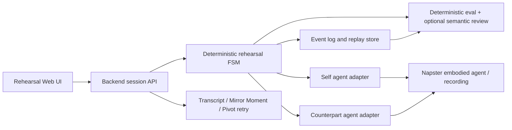

# Architecture sketch — validate before implementation

**Critical uncertainty:** how an avatar is made to say a scripted answer, how/if personalized likeness is created, and whether a WebRTC session can be handed to a human. Napster may provide *recordings* and *live connections* as different products. Treat them separately; do not assume scripted render equals real-time conversational handoff.

## Events and state
- States proposed: `created`, `calibrating`, `double_demo`, `handoff_pending`, `practicing`, `evaluating`, `pivot_retry`, `completed`, `failed`.
- Event must contain `event_id`, `session_id`, `seq`, `actor`, `event_type`, `timestamp`, `payload`, `source` (LIVE/MOCK/PRERECORDED), `correlation_id`, `spec_version`.
- Mutations carry idempotency key. Repeated request cannot duplicate a turn; transitions disallow two simultaneous active speakers per participant.
- Persist hidden counterpart budget/need/constraints before first turn; never let score view leak it before practice unless UI explicitly reveals at end.

## External boundaries
Vendor adapters own credentials, single-flight queue, retry strategy, spend counter and fallback. API key remains server-side. Mock responds via explicit mode flag and marks output. Real video/avatar and scoring are separate: a prerecorded rendered segment cannot prove live two-agent interaction.

## Nonfunctional goals
One coherent 3-minute demo with a reliable happy path and graceful failed mic, slow image/avatar generation, 409/429, disconnected session, and refresh. Accessibility: text-first mode, captions, keyboard, reduced motion. Security: consent and deletion for avatar/voice; short retention; no public log of raw media.
